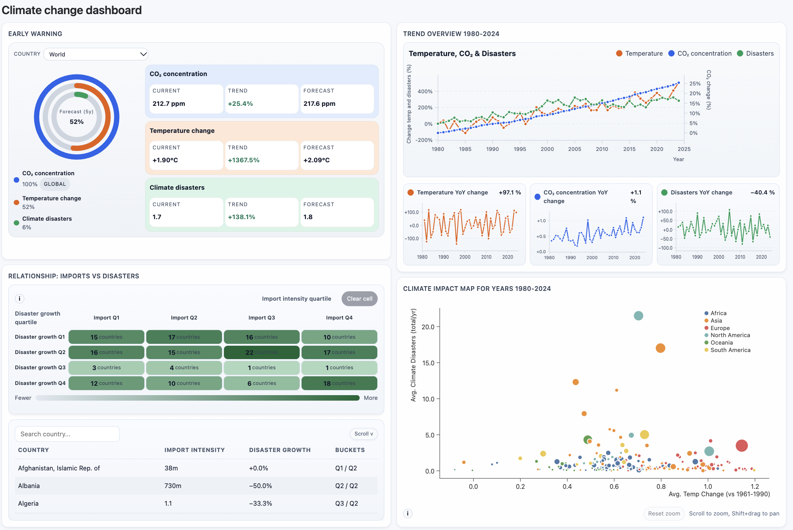

# Climate Disaster Dashboard

An interactive dashboard exploring temperature change, atmospheric CO₂, climate-related disasters, and trade in low-carbon technologies. Built with **Vue 3, D3.js, and Pinia**, it connects four visualizations so users can move from global trends to individual countries and selected groups.

Originally developed as a coursework project, this application demonstrates interactive data visualization, reactive state management, and the integration of multiple CSV datasets in the browser.



## Explore the dashboard

The dashboard supports three central questions:

- How have temperature, CO₂ concentrations, and disaster frequency changed over time?
- How do countries compare in average temperature change and recorded disaster frequency?
- How do countries group by low-carbon technology import intensity and disaster growth?

| View | What it shows | How to interact |
| --- | --- | --- |
| **Early warning** | Circular indicators and a table of latest values, historical trends, and five-year projections for temperature, disasters, and CO₂. | Choose a country or inspect a group selected in another view. |
| **Trend overview** | Percentage change over time, alongside small charts of year-over-year differences. CO₂ has a separate right-hand scale. | Hover for details and compare trends for selected countries. |
| **Country scatterplot** | Average temperature change against average annual disaster counts for 1980–2024. Color represents continent; dot size represents land area. | Hover over a country, click a dot, drag a selection rectangle, or zoom in. |
| **Imports–disasters matrix** | A 4 × 4 matrix grouping countries by quartiles of low-carbon technology import intensity and disaster growth for 1994–2023. | Click a cell to select its countries, inspect the linked table, and search by country name. |

### Try this workflow

1. Start with the trend overview to explore the historical global series.
2. Drag a rectangle over several countries in the scatterplot. The early warning and trend panels update for that selection.
3. Click a matrix cell to compare a group with similar import intensity and disaster growth.
4. Use the matrix's **Clear selection** control to return to the default views.

## Technical highlights

- **Coordinated views:** A shared Pinia store holds country selections, allowing multiple visualizations to respond to the same interaction.
- **Custom visualizations:** D3 provides scales, data transformations, brushing, and zooming, while Vue components render the interface and SVG charts.
- **Data integration:** Country records are joined by ISO3 code, monthly CO₂ observations are aggregated into annual means, and countries are assigned to quartile groups.
- **Reactive calculations:** Vue computed properties derive selected-country averages and chart data as the selection changes.
- **Static application:** CSV files are bundled with the project and processed in the browser; no backend or API credentials are required.

## Run locally

Install Node.js and npm with a version compatible with Vite 5, then run these commands from the project directory:

```bash
npm ci
npm run dev
```

Open the local URL printed by Vite.

To build and preview the production version:

```bash
npm run build
npm run preview
```

The build is generated in `dist/`. Vite is configured with a relative base path (`./`) for serving the built assets under a subdirectory.

## Stack and project structure

| Technology | Role |
| --- | --- |
| Vue 3 | Components, reactivity, and SVG rendering |
| D3.js 7 | Visualization scales, interactions, and data processing |
| Pinia | Shared application state and country selection |
| Bootstrap 5 and custom CSS | Interface styling |
| Vite 5 | Development server and production build |

```text
src/
├── components/
│   ├── EarlyWarningView.vue        # Circular indicators and projections
│   ├── ClimateOverviewView.vue     # Trends and year-over-year changes
│   ├── CountryScatterplotView.vue  # Country comparison, brushing, and zoom
│   └── LctOnDisastersView.vue      # Quartile matrix and country table
├── stores/
│   └── store.js                    # CSV loading, transformations, shared state
├── assets/styles.css
├── App.vue                        # Dashboard layout
└── main.js                        # Application entry point
public/                            # CSV datasets and application icon
```

## Data and methodology

The climate datasets were supplied through the course Moodle platform and identified as IMF data. The repository includes static CSV snapshots in [`public/`](public/); the dashboard does not fetch live updates.

| Dataset | Use in this project |
| --- | --- |
| `14_Climate-related_Disasters_Frequency.csv` | Total recorded climate-related disasters by country and year; main analysis window: 1980–2024. |
| `23_Annual_Surface_Temperature_Change.csv` | Country and world temperature-change series; the scatterplot uses a 1961–1990 reference period. |
| `24_Atmospheric_CO2_Concentrations.csv` | Monthly atmospheric CO₂ observations, averaged by year. |
| `11_Trade_in_Low_Carbon_Technology_Products.csv` | Imports of low-carbon technology products as a percentage of GDP, averaged over 1994–2023. |
| `world_population.csv` | Country area and continent lookup. |

### Interpreting the charts

- **Selections:** The trend overview averages temperature and disaster values across selected countries. Its default view uses the world temperature series and summed disaster counts. The early warning panel averages country metrics for group and default World summaries, so its aggregation differs from the trend overview.
- **CO₂:** Atmospheric CO₂ remains a global series when countries are selected.
- **Trend normalization:** The overview shows percentage change from each metric's first finite, nonzero value. Its small charts show differences from the previous year.
- **Projections:** The early warning panel extends the slope between the first and last historical observations by five years: `latest + ((latest − first) / elapsed years) × 5`. These are simple exploratory extrapolations, not validated climate forecasts.
- **Matrix:** Disaster growth is calculated from the first nonzero count to the final count within 1994–2023. Quartiles describe relative groups within the dataset; the matrix does not establish a causal effect of imports on disasters.
- **Data limitations:** The current numeric conversion treats empty CSV cells as zero. Missing observations and zero baselines can therefore affect averages and percentage changes.

## License

The original application source code is licensed under the [MIT License](LICENSE). Copyright (c) 2026 Ksenia Frank.

Third-party dependencies, the CSV datasets in [`public/`](public/), and [`public/un_icon.ico`](public/un_icon.ico) are excluded from this license and remain subject to their respective copyright and usage terms. The MIT License does not grant permission to reuse or redistribute those third-party materials.
